<p align="center">
  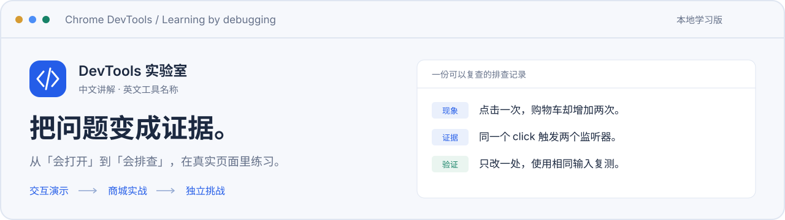
</p>

<h1 align="center">DevTools 实验室</h1>

<p align="center">
  面向懂一点前端、还没系统学过 DevTools 的你。<br />
  在交互模型中理解原理，在真实商城里取证，再用新故障检验方法。
</p>

<p align="center">
  
  
  
  
  
</p>

<p align="center">
  <a href="#快速开始">快速开始</a> ·
  <a href="#看看它的样子">界面预览</a> ·
  <a href="#现在可以学什么">课程范围</a> ·
  <a href="docs/CURRICULUM.md">完整目录</a> ·
  <a href="docs/ROADMAP.md">开发路线</a> ·
  <a href="https://github.com/changfengTech/chrome-devtools-learning/issues">反馈问题</a>
</p>

---

## 把「好像有问题」变成有证据的判断

会打开 Console、会改 Elements 样式之后，遇到重复加购、错误合计、慢请求或异步覆盖，下一步该看哪里？

这个项目以「日常好物」小型商城贯穿课程，练习一条完整的排查路径：**稳定复现 → 提出猜想 → 收集证据 → 解释原因 → 验证修复**。

- **先理解关系**：改变输入、约束和执行顺序，直接观察模型输出；每课补充关键原理与常见误区。
- **再进入真实页面**：检查实际 DOM、CSS、日志、调用栈和 HTTP 请求，Sources 提供可调试的 TypeScript 源码与真实 Source Map。
- **换条件独立排查**：挑战更换数据和故障配置，要求原因、证据与验证方案相互对应。
- **留下自己的方法**：三级提示按需展开；阅读、练习、挑战分别记录，笔记和辅助标记保存在本机，可导入导出。

> 当前是**本地学习版**。第 **01–52** 课共 **52 节**已开放实战；其余 **11 节**显示为课程规划。完整范围为 55 节主线、8 节专题及另列的 8 个面板章末挑战，正在分阶段开发。

## 看看它的样子

### 一张课程地图，找到今天要练的能力

中文解释对应英文 DevTools 名称；可按章节浏览、搜索课程，也能从症状进入排查速查。

[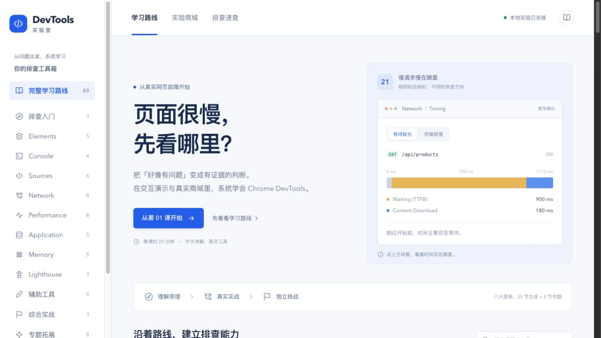](docs/images/home-desktop.png)

<table>
  <tr>
    <td width="50%">
      <a href="docs/images/foundations-sources.png">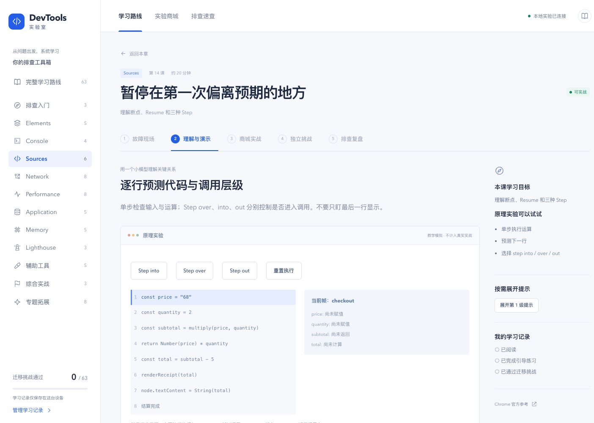</a>
    </td>
    <td width="50%">
      <a href="docs/images/foundations-shop.png">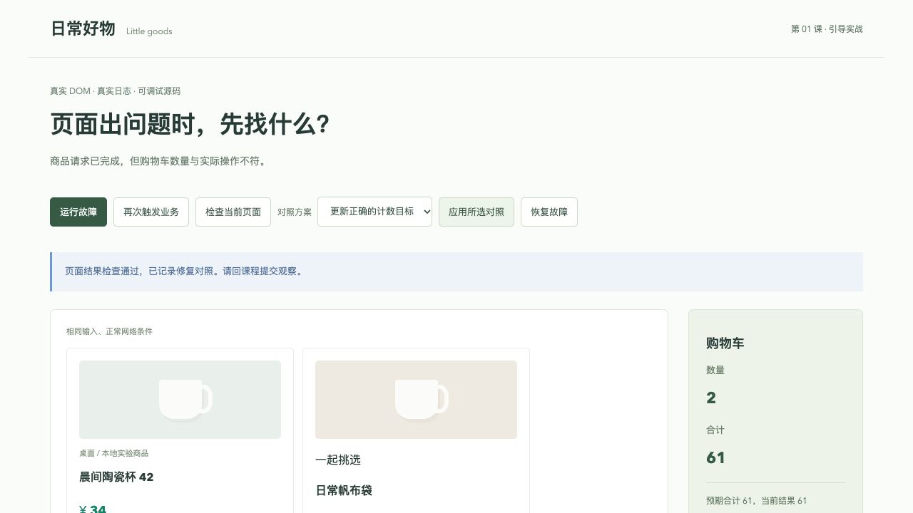</a>
    </td>
  </tr>
  <tr>
    <td><strong>交互模型：看见执行过程</strong><br />预测下一行，比较 Step into / over / out，观察变量与调用层级。</td>
    <td><strong>商城实战：用实际结果核对</strong><br />复现故障，检查节点、日志和源码，用同一输入验证修改。</td>
  </tr>
</table>

### 从真实请求走到持久状态

[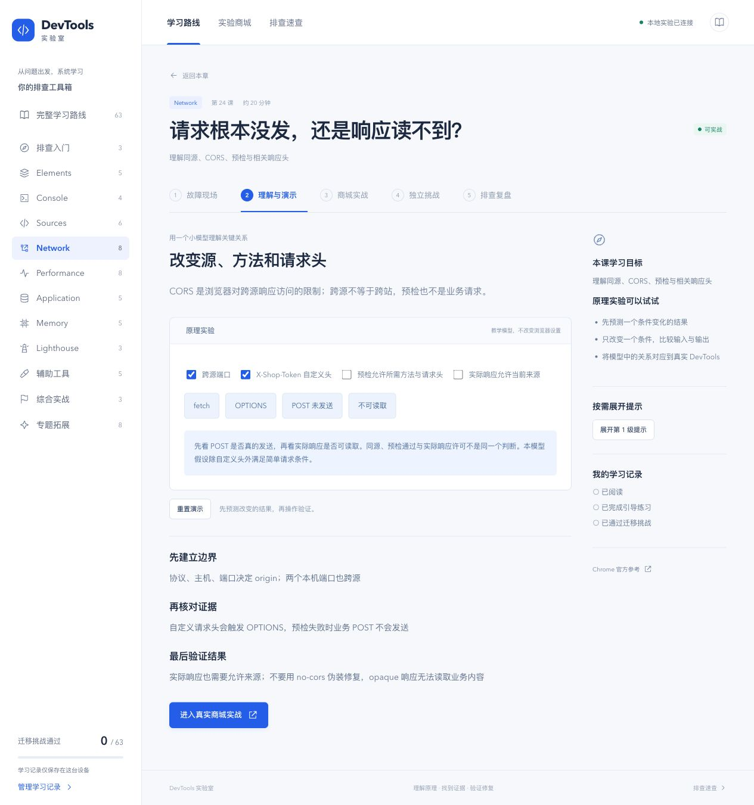](docs/images/network-cors.png)

[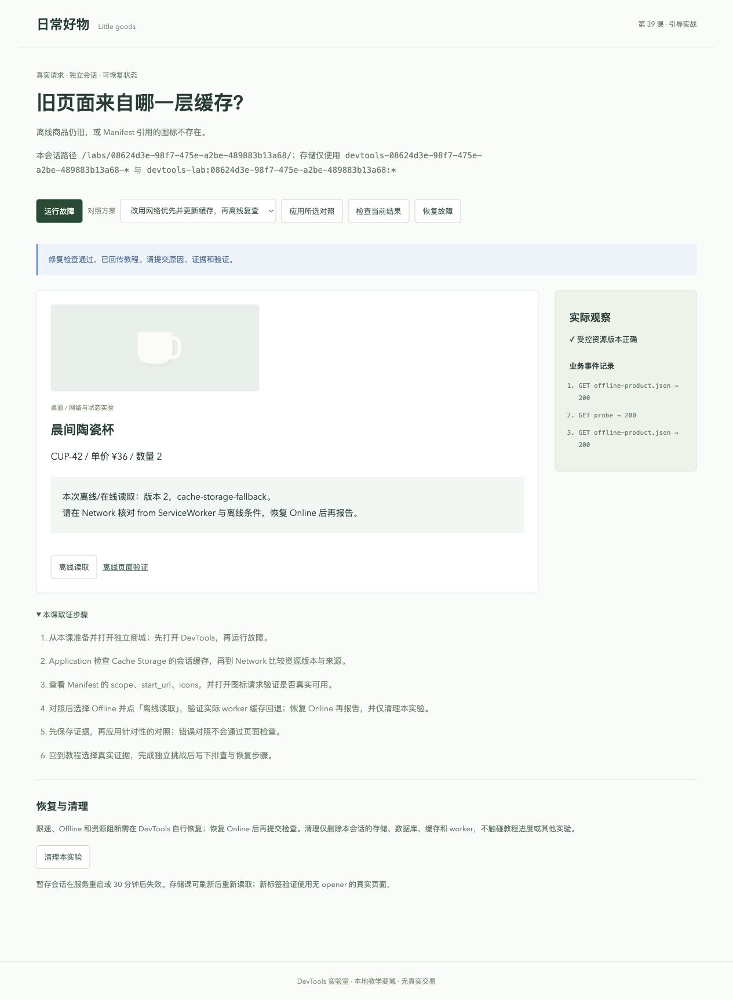](docs/images/application-cache.png)

Network / Application 章末任务起始隐藏课号和操作步骤；完成案例检查后填写报告与五维自评。自评达到门槛才记录完成，不将自评分数称为自动能力认证。

### 从“看起来慢”走到可核对的性能证据

[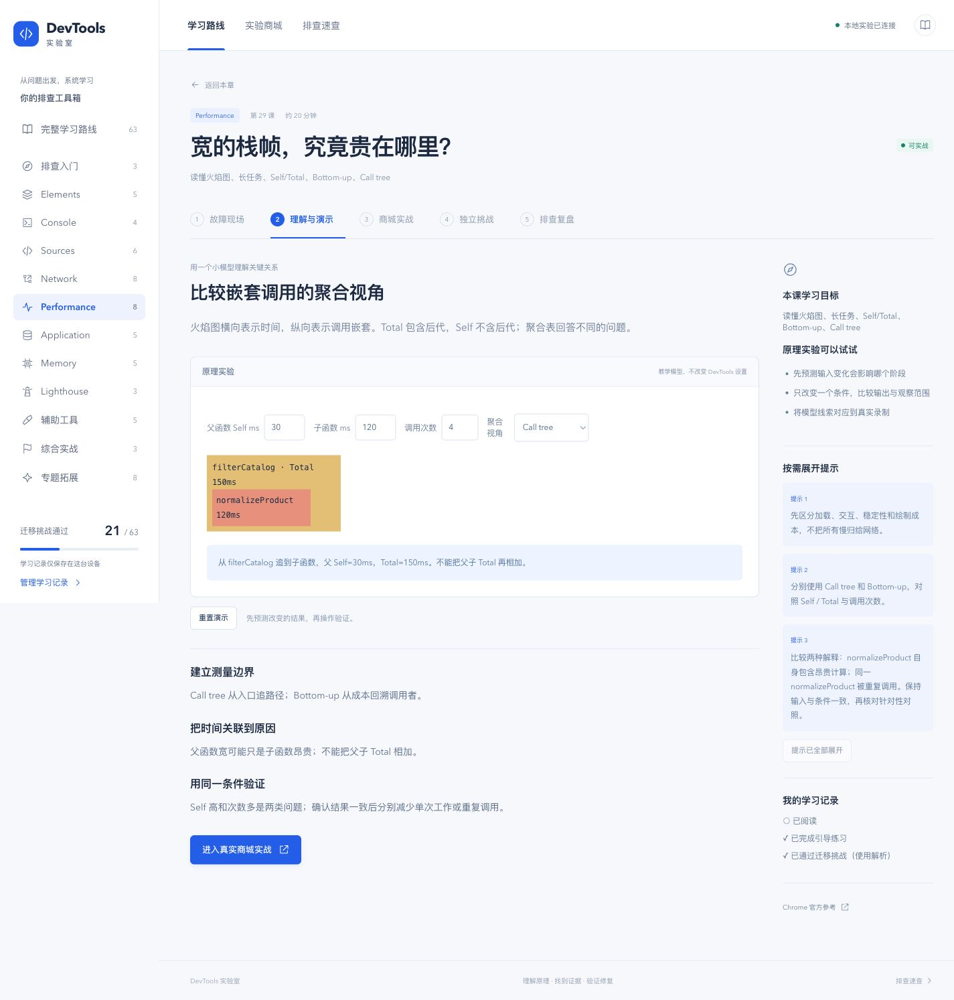](docs/images/performance-model.png)

[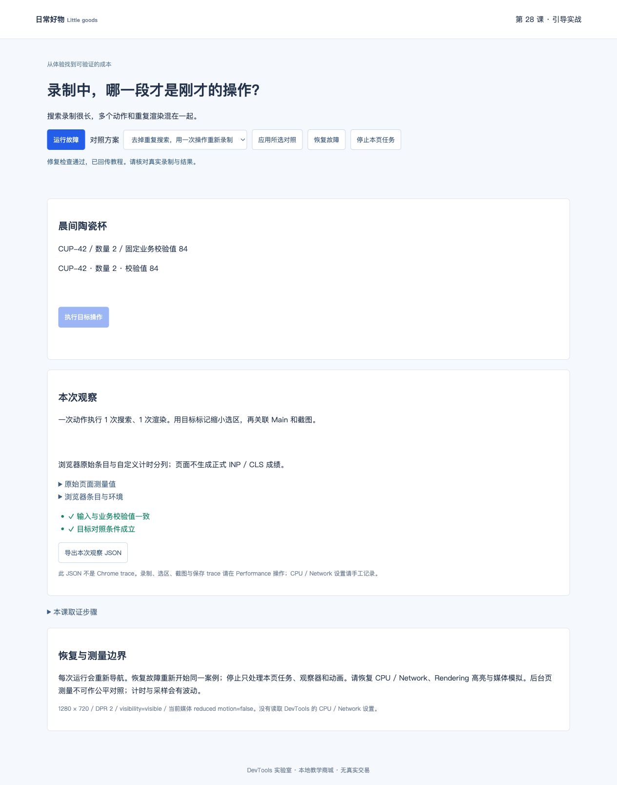](docs/images/performance-shop.png)

性能实验提供真实 CPU 负载、任务切分、资源依赖、布局、按需模块 / 样式及 CSS 动画。原始浏览器条目与自定义计时分列；一次函数耗时不冒称 INP，位置变化不直接换算成 CLS。可查看[原生 trace 与验收证据](docs/QA-PERFORMANCE.md)。

### 从“关闭了”追到“谁还在保留”

<details>
<summary>查看窄屏引用模型：共享根、Shallow 与 Retained Size</summary>

[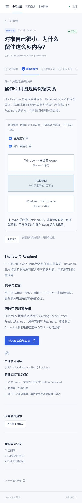](docs/images/memory-model.png)

</details>

[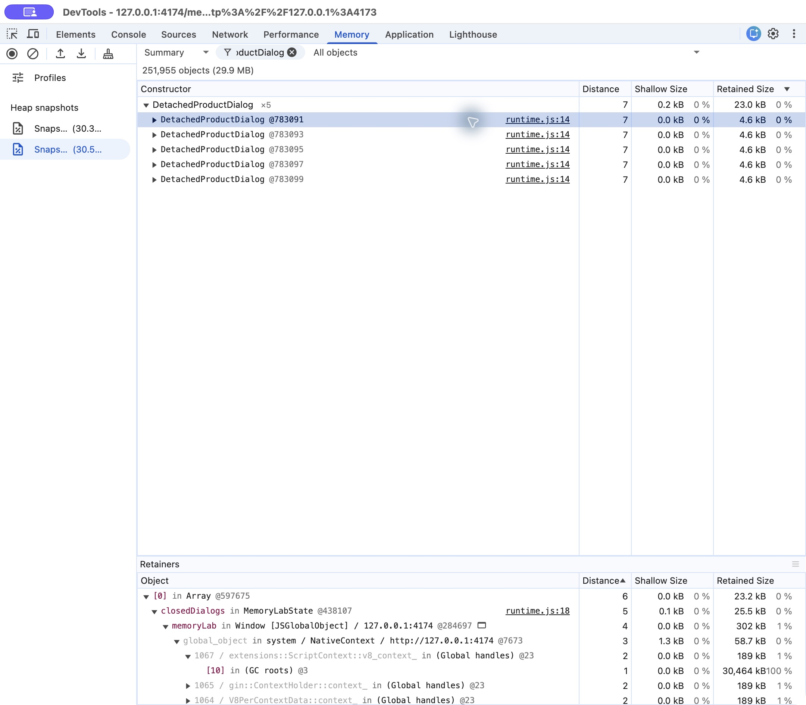](docs/images/memory-retainers.png)

[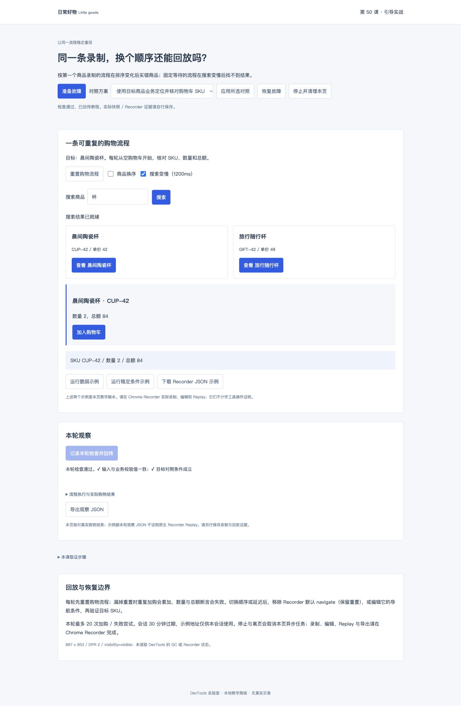](docs/images/memory-shop.png)

内存实验在同一文档做相同操作批次，真实创建对象、节点、事件和定时器；页面计数与原生堆证据分开。Recorder 课提供真实换序 / 异步购物流程，示例脚本不冒充原生 Replay。已验证内容与待补项目见[内存与回归验收](docs/QA-MEMORY.md)。

### 从质量建议走到具体原因与公平复测

[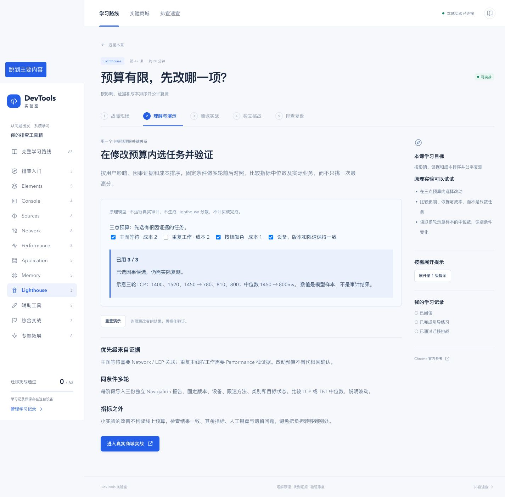](docs/images/quality-model.png)

[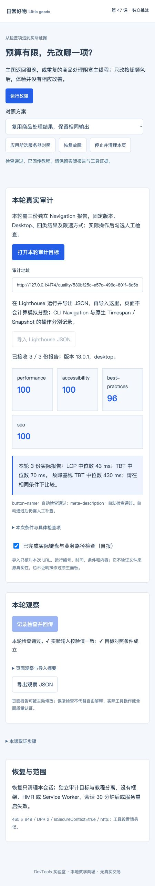](docs/images/quality-report.png)

45–47 只展示导入的真实 Lighthouse 报告；47 每阶段三份独立报告比较中位数。48–49、52 提供真实布局、CSP / Cookie 与商品响应故障。服务器对照与手工 Overrides 分开；[本批证据与待补复核](docs/QA-LIGHTHOUSE-TOOLS.md)明确记录检查范围。

截图来自本地验收会话，点击可查看原图。教学模型与真实商城在界面中分别标注。

## 快速开始

### 1. 准备环境

| 依赖 | 要求 |
| --- | --- |
| Node.js | `^22.18.0` 或 `>=24.12.0`；建议使用符合范围的 LTS 版本 |
| pnpm | 本地验收使用 `12.14.0` |
| 浏览器 | Chrome；课程使用英文面板与控件名称，正文为中文 |

<details>
<summary>还没安装 pnpm？</summary>

安装 Node.js 后，在终端运行：

```sh
npm install -g pnpm@12.14.0
```

通过 `node --version` 和 `pnpm --version` 确认环境。

</details>

### 2. 下载并启动

```sh
git clone https://github.com/changfengTech/chrome-devtools-learning.git
cd chrome-devtools-learning
pnpm install --frozen-lockfile
pnpm dev
```

| 服务 | 开发地址 | 用途 |
| --- | --- | --- |
| 教程 | [127.0.0.1:5173](http://127.0.0.1:5173/) | 课程、交互模型、提示、挑战与学习记录 |
| 商城 | [127.0.0.1:4174/shop/](http://127.0.0.1:4174/shop/) | 独立实验页面与本地 HTTP 服务 |
| 跨源同伴 | `127.0.0.1:4175` | CORS 预检与业务响应，由课程调用 |

`pnpm dev` 同时启动三项服务，只监听本机回环地址；`Ctrl+C` 一起停止。端口被占用时会明确退出，不自动切换到其他端口。

### 3. 完成第一节实战

1. 打开教程，从**第 01 课**开始，在「理解与演示」先预测再操作。
2. 切换「商城实战」，点击「准备引导实验」，再点击「打开引导商城」。
3. 保留教程窗口，在商城打开 DevTools，点击「运行故障」。
4. 按课程步骤查找证据；手工修改后检查页面，或应用针对性的对照方案。
5. 回到教程提交观察证据，再生成「独立挑战」，排查新案例并写下复盘。

基础课的会话实验入口为 `/foundations/`，网络与状态课使用 `/labs/<token>/`，性能课使用 `/performance/<token>/`，内存 / 回归使用 `/memory/<token>/`，均由课程生成。直接访问商城主页适合自由观察；**记录练习与挑战时，请从对应课程准备会话**。

## 每节课怎样展开

| 步骤 | 你会做什么 | 希望留下的依据 |
| --- | --- | --- |
| 故障现场 | 说明正常行为，稳定复现异常 | 起始状态、输入、动作、预期与实际差异 |
| 理解与演示 | 调整模型条件，理解关键原理 | 哪个条件改变了什么结果，为什么 |
| 商城实战 | 在真实 DevTools 中检查并复测 | 节点、规则、变量、调用关系或请求时序 |
| 独立挑战 | 面对新数据与另一种故障作判断 | 原因、证据和针对性验证能否互相印证 |
| 排查复盘 | 保存阅读状态与自己的笔记 | 现象、根因、最小修改、复测与不确定范围 |

提示不会锁住后续课程。查看案例解析后的挑战会记录为**使用辅助完成**；已阅读、已练习和挑战通过保持独立。

## 现在可以学什么

### 已开放 · 52 节

| 章节 | 课次 | 主要练习 |
| --- | --- | --- |
| 排查入门 | 01–03 | 面板选择、稳定复现、证据意识、origin 与实验条件 |
| Elements | 04–08 | DOM 定位、样式覆盖、网格溢出、遮挡与禁用、名称与标签关联 |
| Console | 09–12 | 日志过滤、错误与堆栈、iframe 上下文、对象快照与异步计时 |
| Sources | 13–18 | Source Maps、单步执行、Scope / Watch / Call Stack、条件与事件断点、异常与异步 |
| Network | 19–26 | 过滤与 Initiator、请求契约、Timing、瀑布图、HTTP 缓存与 304、CORS、失败恢复、SSE / WebSocket |
| Performance | 27–34 | 测量目标、有效录制、火焰图、任务切分、关键路径、Layout shifts、Rendering 与 Coverage |
| Application | 35–39 | Cookie、跨标签页存储、IndexedDB 事务、Service Worker 生命周期、Cache Storage 与 Manifest |
| Memory | 40–44 | 可达性、GC、Heap snapshot、Shallow / Retained Size、Comparison、分配、Retainers、Detached DOM、监听器与 timer 清理 |
| Lighthouse | 45–47 | 审计模式与条件、四类别、具体元素与资源、优先级与三次中位数复测 |
| 辅助工具 | 48–49、52 | Device Mode、Issues / Privacy and security、Local overrides、Changes 与 Workspaces 范围 |
| Recorder | 50 | 稳定业务定位、异步条件、重置、购物结果断言与回归流程 |
| Animations | 51 | 捕获、时长与延迟、暂停 / 重放、真实 prefers-reduced-motion 对照 |

基础课各有两种故障配置。引导案例固定，迁移题随机选择配置，并变化价格、数量或 SKU；不同课程使用与其目标相符的检查结果。

<details>
<summary>展开查看已开放课程清单</summary>

| 课次 | 课程 | 课次 | 课程 |
| --- | --- | --- | --- |
| 01 | 认识 DevTools | 24 | 浏览器为什么拦截请求 |
| 02 | 用证据排查问题 | 25 | 弱网、断网和资源阻断 |
| 03 | 管理实验条件 | 26 | 检查持续连接 |
| 04 | 从页面定位 DOM | 27 | 给「慢」分类 |
| 05 | 为什么样式没生效 | 28 | 录制一份有效报告 |
| 06 | 看懂布局 | 29 | 找到真正耗时的函数 |
| 07 | 检查状态与事件 | 30 | 输入为什么没有及时响应 |
| 08 | 页面是否容易使用 | 31 | 首屏关键内容为何出现晚 |
| 09 | 从日志中找线索 | 32 | 页面为什么突然跳动 |
| 10 | 阅读错误与堆栈 | 33 | 布局与绘制为什么昂贵 |
| 11 | 用表达式验证猜想 | 34 | 页面加载了多少没用到的代码 |
| 12 | 记录可信的值和耗时 | 35 | 登录状态与 Cookie |
| 13 | 找到值得看的源码 | 36 | Local 与 Session Storage |
| 14 | 暂停与单步执行 | 37 | 检查 IndexedDB |
| 15 | 检查变量与调用关系 | 38 | Service Worker 如何接管请求 |
| 16 | 只在需要时停下来 | 39 | 离线资源与应用信息 |
| 17 | 从行为追到代码 | 40 | 内存增长一定是泄漏吗 |
| 18 | 捕获异常与异步问题 | 41 | 读懂堆快照 |
| 19 | 找到一次操作的请求 | 42 | 比较与追踪分配 |
| 20 | 检查请求与响应契约 | 43 | Detached DOM 为什么仍在内存里 |
| 21 | 慢请求慢在哪里 | 44 | 找到对象为何无法释放 |
| 22 | 谁发起请求，为什么现在才发 | 50 | Recorder 复现与回归 |
| 23 | 为什么总是旧数据 | 51 | Animations 调试 |
| 45 | 正确运行一次审计 | 48 | Device Mode |
| 46 | 解读质量检查结果 | 49 | Issues 与安全检查 |
| 47 | 优先级与公平复测 | 52 | Overrides、Changes 与 Workspaces |

第 01–18 课见 [基础课脚本](docs/FOUNDATIONS-01-18.md)；第 19–26、35–39 课见 [网络与状态合同](docs/NETWORK-APPLICATION.md)，其中第 21 课沿用 [样板脚本](docs/LESSON-21.md)；27–34、51 见 [性能与渲染合同](docs/PERFORMANCE-RENDERING.md)；40–44、50 见 [内存与回归合同](docs/MEMORY-REGRESSION.md)；45–49、52 见 [质量与工具合同](docs/LIGHTHOUSE-TOOLS.md)。均包含目标、操作、故障合同、提示与参考答案。

</details>

### 后续 · 11 节与其余章末挑战

完整规划覆盖八大面板：Elements、Console、Sources、Network、Performance、Memory、Application、Lighthouse。

- [x] Network 与 Application：13 节完整实战及两个面板章末任务已交付。
- [x] Performance 与渲染：27–34、51 共 9 课及性能章末任务已交付。
- [x] Memory 与回归：40–44、50 共 6 课和 Memory 章末功能已交付；原生工具补充验收待办见记录。
- [x] Lighthouse 与辅助工具：45–49、52 共六课和 Lighthouse 章末功能；原生面板补充复核见验收记录。
- [ ] 三个综合实战、其余三个面板章末挑战，以及 Sensors、真机调试、Media、WebAuthn、CDP 等专题。

以上未勾选项是**开发计划**，尚未开放对应完整实验。课内迁移题与面板章末挑战分别设计，不将逐课通过当作章末能力认证。具体顺序见 [开发阶段](docs/ROADMAP.md)，逐课四要素见 [完整目录](docs/CURRICULUM.md)。

## 教程与商城为什么分开运行

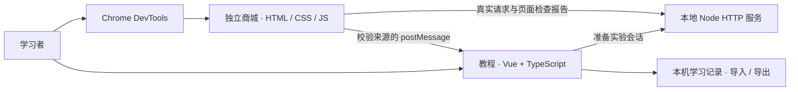

教程负责教学流程；商城提供可检查的实际页面、事件、日志和请求，不注入教程的 Vue 实例或 HMR。两个源使用不同端口，减少教程本身对实验的干扰。核心实验不需要业务账号、真实交易或外部商品接口。

- **源码可以追进去**：`shop-cart.ts` 实际编译为 JavaScript，并生成含源码的 `.map`。
- **状态各有边界**：真实 HTTP 缓存、IndexedDB、Cookie、SSE / WebSocket 和 Service Worker 分开观察；worker scope、数据库、键和缓存按会话隔离，清理只处理自己的实验，过期会话也能清理。
- **故障能够恢复**：商城可恢复当前故障；重新准备会话可重新开始观察。
- **检查依据说清楚**：自动检查核对会话、请求完成、实验页报告与结构化答案，不读取你的 DevTools 点击；自由笔记用于自查，不靠关键词打理解分。

第 18 课的竞态使用真实定时异步任务；HTTP 时序在网络课中单独学习。受控修复用于验证当前案例，结论仍需结合真实项目的环境与证据。

## 开发与验证

| 命令 | 用途 |
| --- | --- |
| `pnpm dev` | 同时启动教程 5173、商城 4174 与跨源服务 4175 |
| `pnpm build` | 商城 TS 检查与编译、Source Map、Vue 类型检查、生产构建 |
| `pnpm preview:all` | 同时启动生产预览 4173、商城 4174 与跨源服务 4175 |
| `pnpm test` | 运行 Node 测试，覆盖场景接口、判定、Source Map 与记录校验 |
| `pnpm docs:curriculum` | 根据课程数据重新生成完整目录 |
| `pnpm docs:lessons` | 生成 01–18、19–20、22–26、35–39、27–34、51、40–44、50、45–49、52 共 51 份脚本与共同合同 |
| `pnpm lab:build` | 修改商城 TS 后重新生成调试业务 JS 与 Source Map |
| `pnpm lab:type-check` | 单独检查商城业务 TypeScript |
| `pnpm dev:web` / `pnpm dev:lab` | 分别启动教程和商城 |

生产预览：

```sh
# 先用 Ctrl+C 停止开发服务，避免占用同一商城端口
pnpm build
pnpm preview:all
```

之后访问 [127.0.0.1:4173](http://127.0.0.1:4173/)。`pnpm preview` 只启动前端预览；完整实战需要 `pnpm preview:all`。测试临时监听本机随机端口，受限环境需允许本地回环监听。

### 已有的验收证据

- `pnpm build` 与 **47 项自动测试**通过，覆盖基础、网络状态、性能与内存配置、错误提交、会话隔离、实际协议、Source Map、记录校验和第 21 课回归。
- 18 课引导实验在浏览器中连续完成 **3 轮**故障与修复；两种故障配置均已覆盖。
- 18 课分别检查 320、768、1440 三种宽度，共 **54 项**无整页横向溢出。
- 真实业务代码已验证暂停、调用栈与单步；记录导入导出、刷新保留、辅助标记和错误导入均有检查。
- 新增 12 课各完成三轮引导、两组独立挑战与模型操作；13 课及两个章末页面另有 **45 项**响应式检查。HTTP 缓存 / 304、CORS、持续连接、状态与 worker 均有实际证据。
- 性能阶段新增 9 个模型、三轮引导和两组挑战，30 项响应式检查通过；原生 trace 采样到目标函数，LayoutCount 对照、JS / CSS Coverage 及真实 reduce 媒体条件均有证据。Performance 章末及三个章末记录兼容检查通过。
- Memory / 回归 6 课三轮引导、两组挑战和 21 项响应式检查通过，原生快照显示命名对象与实际 Retainers；四章末兼容、非法导入保护和 Recorder 格式逐步执行有记录。第三份原生快照比较、分配工具及 Recorder 原生 Replay 仍待复核。
- 质量与辅助工具六个模型、86 份真实 Lighthouse 报告、21 项课程 / 章末及 9 项商城布局检查通过；LCP / TBT 三次中位数对照、CSP / Cookie 真实诊断、响应替换、第五个章末和五章末导入均有记录。六课三轮完整引导和两组挑战已覆盖；原生面板人工复核仍列待办。
- Network / Application 两个章末任务检查低分门槛与记录持久化；实际网络失败时缓存回退通过，资源阻断后收尾与恢复重试通过；生产预览 24 / 25 / 39 全链路通过。

以上为已记录环境的结果。流程验收使用应用内 Chromium；原生 Memory 另在 Google Chrome 英文面板取得部分证据。完整版本及原生工具逐项复核仍有待办，未把示例脚本称为原生回放。详见 [基础课验收](docs/QA-FOUNDATIONS.md)、[网络与状态验收](docs/QA-NETWORK-APPLICATION.md)、[性能验收](docs/QA-PERFORMANCE.md)、[内存验收](docs/QA-MEMORY.md)、[质量与工具验收](docs/QA-LIGHTHOUSE-TOOLS.md) 与 [实施状态](docs/STATUS.md)。

## 项目结构

```text
chrome-devtools-learning/
├── src/
│   ├── components/            # 课程容器、51 种交互模型、Timing 与章末任务
│   ├── data/                  # 完整目录、基础、网络状态、性能、内存及质量脚本
│   ├── composables/           # 学习状态
│   └── lib/                   # 实验通信与记录校验
├── public/lab/
│   ├── foundation/            # 01–18 课独立商城、TS 与 Source Map
│   ├── network-state/         # 12 个真实网络与状态实验、会话 worker
│   ├── performance/           # 9 个真实性能 / 渲染实验及独立动画
│   ├── memory/                # 6 个真实内存 / 稳定购物流程实验
│   ├── quality/               # 6 个真实质量 / 辅助工具实验与独立审计目标
│   └── shop.*                 # 第 21 课网络时序商城
├── server/                    # 本地 HTTP 服务、会话与结果判定
├── scripts/                   # 服务启动、业务编译、QA 与文档生成
├── tests/                     # 场景、接口、映射与记录测试
└── docs/                      # 产品、目录、脚本、路线、验收与截图
```

## 文档导航

| 想了解什么 | 从这里开始 |
| --- | --- |
| 面向谁、怎样学、完整边界 | [产品约定](docs/PRODUCT.md) |
| 全部课程目标、演示、实战与挑战 | [63 节完整课程目录](docs/CURRICULUM.md) |
| 每阶段交付与退出条件 | [开发路线](docs/ROADMAP.md) |
| 01–18 课的操作、实验合同及参考答案 | [基础课详细脚本](docs/FOUNDATIONS-01-18.md) |
| 19–26、35–39 课的合同、脚本与章末任务 | [网络与状态详细脚本](docs/NETWORK-APPLICATION.md) |
| 27–34、51 课的实验边界与脚本 | [性能与渲染合同](docs/PERFORMANCE-RENDERING.md) |
| 40–44、50 课的引用、清理及回归约定 | [内存与回归合同](docs/MEMORY-REGRESSION.md) |
| 45–49、52 课的真实审计、设备、规则与覆盖约定 | [质量与辅助工具合同](docs/LIGHTHOUSE-TOOLS.md) |
| 第 21 课的完整教学设计 | [Network 样板课](docs/LESSON-21.md) |
| 自动检查边界与章末评分规则 | [验收标准](docs/ACCEPTANCE.md) |
| 实测了什么、还缺什么 | [基础课验收](docs/QA-FOUNDATIONS.md) · [网络与状态验收](docs/QA-NETWORK-APPLICATION.md) · [性能验收](docs/QA-PERFORMANCE.md) · [内存验收](docs/QA-MEMORY.md) · [质量与工具验收](docs/QA-LIGHTHOUSE-TOOLS.md) · [实施状态](docs/STATUS.md) |
| 三个本地服务、接口、通信与存储 | [实验架构](docs/ARCHITECTURE.md) |
| 视觉与可读性约定 | [界面设计](docs/DESIGN.md) |

## 常见问题

<details>
<summary>教程能打开，为什么显示「实验服务未连接」？</summary>

请在项目根目录运行 `pnpm dev` 或 `pnpm preview:all`，让 4174 商城服务也启动。只启动 Vite 前端不足以完成实战。检查终端中的端口占用信息，并优先使用文档中的 `127.0.0.1` 地址。

</details>

<details>
<summary>准备了实验，却打不开商城窗口？</summary>

先点击准备，再手动点击「打开引导商城」或「打开挑战商城」。若浏览器提示拦截弹窗，允许当前本地站点打开实验窗口后重试，并保留教程窗口接收结果。

</details>

<details>
<summary>服务重启或页面刷新后，还能接着练吗？</summary>

学习笔记、阅读、练习及挑战记录保存在 localStorage，刷新后保留。临时会话在服务内存中，30 分钟后或服务重启会失效；回课程重新准备即可。重新准备不会删除已保存的学习记录。

</details>

<details>
<summary>怎样备份学习记录？</summary>

在「学习记录」中导出 JSON，更换环境后再导入。导入会替换当前本机记录，建议先备份；校验失败不会覆盖旧记录。不同协议、主机或端口属于不同源，看到的本地记录也可能不同。

</details>

<details>
<summary>为什么修改后又变回故障状态？</summary>

Elements 中的 DOM/CSS 修改是临时实验。刷新、恢复故障或重新应用对照会重新渲染。源码类任务可以先暂停观察，再用参考对照复测。实验结束后请清除断点，恢复异常暂停、限速与阻断等设置，避免影响下一课。

</details>

<details>
<summary>公开仓库能直接用 GitHub Pages 完成全部实战吗？</summary>

当前版本需要本地 Node HTTP 服务来制造真实响应时序、管理会话和检查结果，单独静态托管前端不能提供完整实战。请按上面的本地启动步骤运行；当前没有附带公开在线实验后端。

</details>

## 参与改进

欢迎通过 [Issues](https://github.com/changfengTech/chrome-devtools-learning/issues) 反馈课程疑问、复现问题和新案例。描述问题时附上课号、Chrome 版本、起始条件、操作步骤、预期与实际结果，通常更容易定位。

课程修改以数据源为准：`src/data/curriculum.json` 管完整目录，`src/data/foundations.json` 管基础课内容，`src/data/network-state.json` 管网络与状态课内容，`src/data/performance.json` 管性能与渲染课内容，`src/data/memory.json` 管内存与回归课内容，`src/data/quality.json` 管质量与辅助工具课内容，合同补充维护在 `scripts/generate-foundations.mjs` 、`scripts/generate-network-state.mjs` 、`scripts/generate-performance.mjs` 、`scripts/generate-memory.mjs` 与 `scripts/generate-quality.mjs`。更新后运行对应文档生成命令；修改业务逻辑时一并核对故障、修复、随机挑战和重置行为。

提交前运行 `pnpm build` 与 `pnpm test`，并更新实际受影响的验收记录。新增内容验证通过后再标记「可实战」，让课程状态与真实能力保持一致。

---

<p align="center">
  选对工具，找到证据，解释原因，验证修复。
</p>
