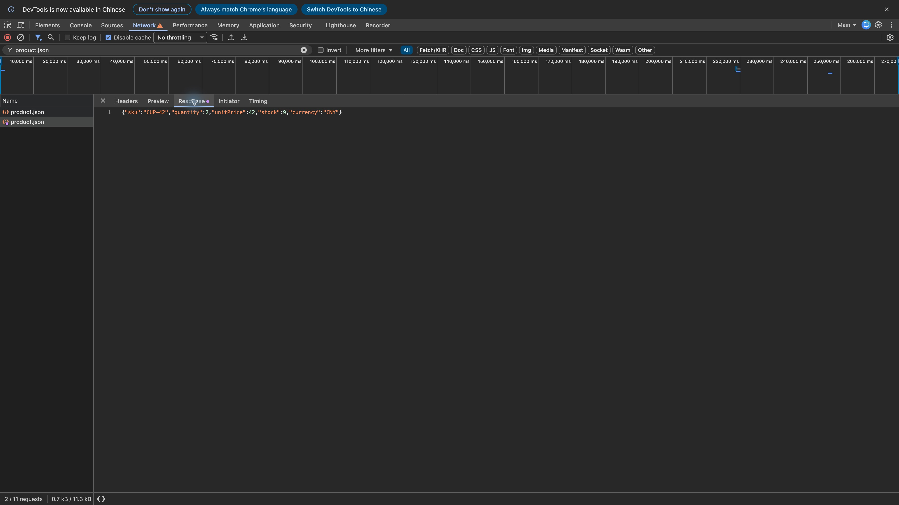
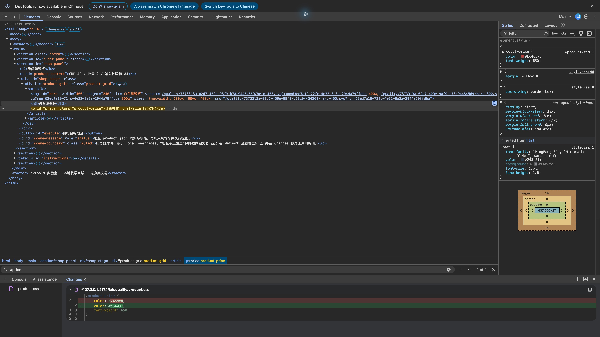
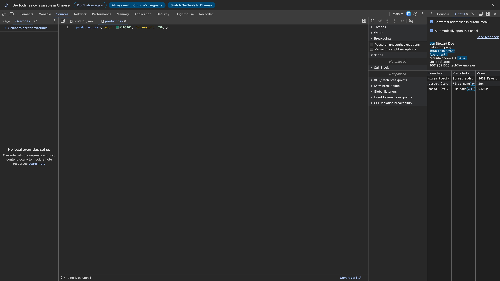

# Overrides、Changes 与 Autofill 原生补验

日期：2026-10-22。基线：`7cbe8c2e891d67087ffb33d1042cca86e8680013`。使用 macOS 上 Google Chrome 156.0.8078.48 的 **Guest（访客）**窗口、英文 DevTools 和本地商城。访客环境没有登录账户、已存地址或个人浏览资料。本次只补验 52 与 T05 的代表性条件，不重复计入上一轮 63 课 / 8 章末功能回归。

## 结论与证据

| 项目 | 实际操作与结果 | 范围 |
| --- | --- | --- |
| Local overrides | 原生选择已授权目录、Allow、Network → Override content、Code editor 保存；Network 出现紫色覆盖标记，Response 为数值 `unitPrice:42` | 第 52 课单价类型故障，未宣称响应头覆盖和所有迁移条件均原生复走 |
| 覆盖闭环 | 单价恢复 42，CUP-42 / 数量 2 / 总额 84，页面检查通过；禁用 Local overrides 后重新读取同一 URL，`unitPrice 应为数值` 故障恢复 | HTTP 独立请求仍是字符串 `"42"`，与原生 Response 证据分列 |
| Changes | Elements → Styles 修改颜色，Changes 显示 `#245de8` 删除、`#b64037` 新增；恢复原值后显示文件与未修改状态相同 | 当前界面未显示旧文档的 Revert 操作栏，实际使用 Styles 恢复；未把 Revert 或复制按钮计作通过 |
| Autofill | Chrome 内置美国测试地址实际填充；故障时名称 / 街道互换，修复后正确；Form inspector 的预测与实际值均核对 | 同一内置地址、同一表单；不代表 billing / shipping 双地址组隔离或各国启发式穷举 |
| 恢复 | 覆盖关闭、Clear configuration 后显示 No local overrides set up；测试地址与 Disable cache 均回到 Off；手动清空三个字段、停止实验、关闭访客及自建辅助空白窗口 | 原普通配置既有覆盖目录保持原状；没有修改用户学习记录 |

[结构化结果](qa/native-followup/evidence.json)保留了观察值和恢复项。图中地址、姓名、邮箱、电话均来自 Chrome 自带的合成测试数据，不是个人资料。截图逐张检查后纳入仓库。

## 52：验证修改发生在浏览器本地

1. 在访客 DevTools 的 Sources → Overrides 选择 `/private/tmp/devtools-release-overrides`，确认授权。另一已授权目录 `/private/tmp/devtools-release-workspace` 本轮没有重新添加；上一轮 Workspace 保存与移除证据保留。
2. 第 52 课运行故障，Network 找到 `product.json`。原始字段为 `unitPrice:"42"`、`stock:9`。右键该请求 → Override content，只将价格改为数值 42，Cmd+S。独立读盘确认覆盖文件内容。
3. 页面点击“检查手工覆盖”，保持故障服务器并重新获取同一 URL。原生 Network 的请求图标可访问名称为 **Request content is overridden**；Response 展示 `unitPrice:42`。加入购物车后检查通过。
4. 同 URL 的独立 HTTP 请求返回 200，内容仍为 `unitPrice:"42"`。此项是服务端交叉核对，不是原生面板证据。
5. 取消 Local overrides，再点“检查手工覆盖”，计算类型错误重新出现。页面断言、原生标记、Response、独立 HTTP 和禁用回归共同构成证据，不能只凭紫点推断业务修复。



[覆盖前 JSON](qa/native-followup/overrides-before.jpg) · [Network 覆盖标记](qa/native-followup/network-overrides-marker.jpg) · [业务检查通过](qa/native-followup/overrides-fixed-page.jpg) · [禁用后的页面](qa/native-followup/overrides-disabled-page.jpg)。最后一图错误文字在视口下方，具体错误值由结构化结果记录；不把图片未展示的文字说成可见。

## Changes：差异与恢复

先在 Sources 保存本地 CSS 覆盖副本时，Changes 显示 No changes yet，因此该次操作没有被记作 diff 成功。随后在 **Elements → Styles** 选择 `#price` 的 `.product-price`，把颜色改为 `#b64037`，Changes 实际显示以下差异：

```diff
- color: #245de8;
+ color: #b64037;
```



恢复颜色为 `#245de8` 后，Changes 显示 **File is identical to its unmodified state**，增删行消失。文件仍可能带 `*`，不能只用星号判断是否还有内容差异。本轮未看到官方旧版示例中的 Revert 操作栏，未声称点击过该按钮。[恢复截图](qa/native-followup/changes-restored.jpg)。仓库 `product.css` 没有修改；Sources 中另一个先前保存的本地覆盖副本不等于仓库源文件。

## T05：Chrome 实际填充与预测

打开 Autofill，启用 **Show test addresses in autofill menu**。在真实街道字段打开自动填充菜单，进入 **Developer tools（开发者工具）→ United States（美国）** 并确认。可点击字段后用 Down / Right 展开；官方文档也给出右键字段入口。全过程没有导入地址、登录账户或提交表单。

先记录原生填充，再使用课堂“执行目标流程”解锁对照；课堂按钮的虚构 token 填值不计作原生填充证据。修复 token 后，对空白的新字段使用同一个 Chrome 内置地址再次填充。最后“恢复故障”后又实际填充一次，确认错误复现。

| 字段 | 故障时预测 / 实际值 | 修复后预测 / 实际值 |
| --- | --- | --- |
| given（收货人） | Street address / `1600 Fake Street, Apartment 1` | First name / `Jon` |
| street（街道） | First name / `Jon` | Street address / `1600 Fake Street, Apartment 1` |
| postal（邮编） | ZIP code / `94043` | ZIP code / `94043` |

上述三个预测均标记 **attr**，即 autocomplete attribute。不能将浏览器遵循这组 token 的结果外推为所有无 token 表单的启发式表现。

| 故障的原生映射 | 修复后的原生映射 |
| --- | --- |
|  |  |

[故障表单实际值](qa/native-followup/autofill-fault-page.jpg) · [修复表单实际值](qa/native-followup/autofill-fixed-page.jpg) · [手动清空后](qa/native-followup/autofill-cleaned.jpg)。停止按钮清理会话资源后表单值仍在，所以本轮额外手动清空了三个字段再关闭窗口。

## 需要设备、账户或其他条件的项目

| 条件类别 | 项目 | 当前边界与后续关闭条件 |
| --- | --- | --- |
| 真机必需 | T02 Android 远程调试 | 需要授权测试 Android、USB 与设备端调试确认；补 inspect 目标、端口转发、设备上购物流程和撤销。Device Mode 不代替真机 |
| 账户 / 功能资格 | T07 AI assistance | 需要可用 Google 账户、地区 / 管理策略允许；本轮没有登录或接受条款。满足条件后只用公开合成上下文验证建议及独立复测 |
| 单独权限 | T01 Sensors 定位 | 仍缺测试页位置权限下的实际定位结果；已有方向模拟。需要明确授权该测试页的位置权限，不需要个人真实位置或账户 |
| 可选真机扩展 | T06 实体认证器、其他移动设备差异 | 虚拟 WebAuthn 原生注册 / 签名已有上一轮证据；实体硬件或生物识别不算已验，也不是本地虚拟教程的必需条件 |
| 本地继续补验 | Workspace 自动映射、Protocol monitor 旧 nodeId、其他面板细项 | 不依赖个人账号或真机，保留在整体验收待办；Changes 的 Revert 按钮按实际版本能力单列，billing / shipping 双地址组另测 |

Autofill 内置测试地址、Overrides / Changes 本轮不再列为“需要个人地址或账号才能验收”。阶段 8 其他原生退出条件仍见[剩余项](QA-RELEASE.md#尚未关闭的验收项)。

## 工程检查与恢复范围

同步修正 T05 课程脚本与商城提示，明确 Chrome 内置地址入口、面板预测核对和清理；52 脚本明确 Elements 样式差异与恢复的版本边界。生成脚本保持单一数据源。测试、构建、文档链接和证据哈希结果见[检查记录](qa/native-followup/validation.json)。这次不把上一轮 60 测试、213 项布局或 63 课结果再次算作新增浏览器回归。

临时目录中的公开测试副本保留在本机，授权从本轮访客 DevTools 配置移除。没有把整个目录、浏览器配置、学习记录、完整个人页面截图或未经筛选的窗口树提交到公开仓库。日常本地随机服务继续运行。

## 官方参考

- [Local overrides](https://developer.chrome.com/docs/devtools/overrides)
- [Changes](https://developer.chrome.com/docs/devtools/changes)
- [Autofill：内置测试地址与 Form inspector](https://developer.chrome.com/docs/devtools/autofill)
