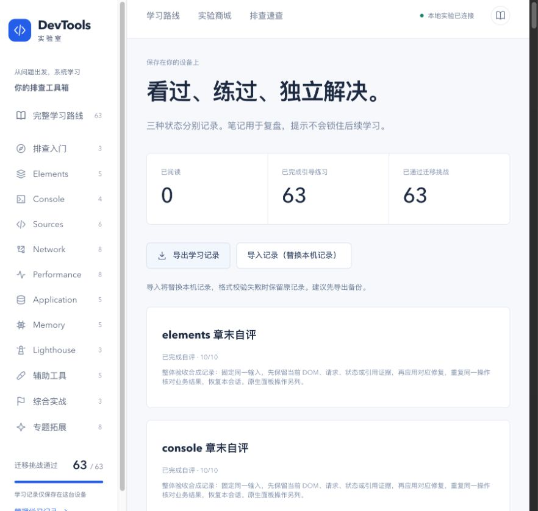
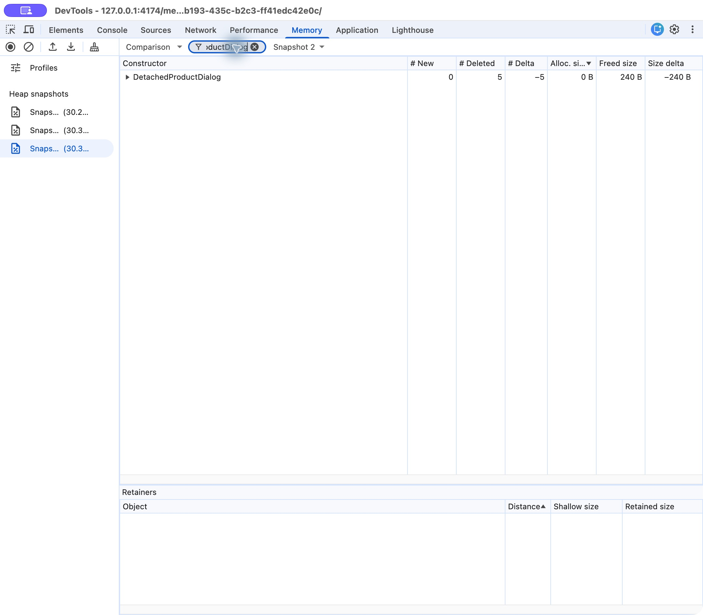
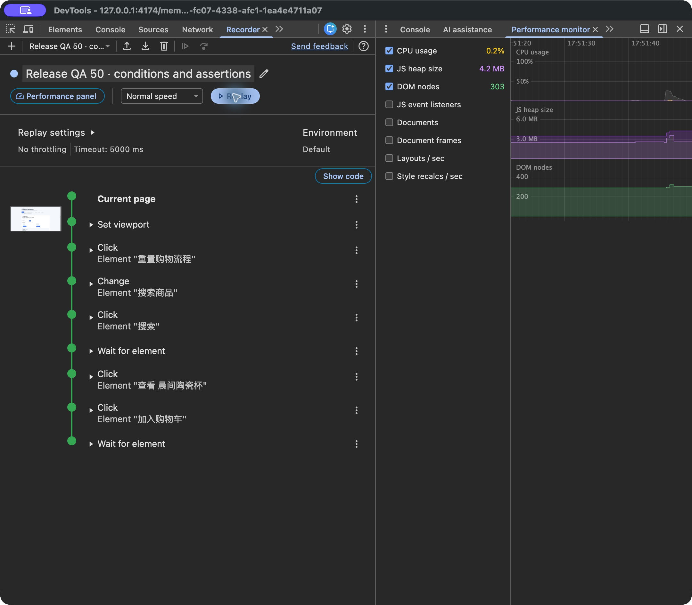

# 整体验收记录

日期：2026-10-22。起始提交：`12c1d7f255cf4cd389d8e43a35a9839626319198`。范围：01–55、T01–T08 共 **63 课、8 个面板章末**。本轮完成全课程功能回归，修复两处问题，并补充独立 Chrome 英文面板证据。仍缺少证据的原生步骤列在后文；**没有把阶段 8 标记为全部原生验收关闭**。

## 本轮结论与证据

| 项目 | 本轮结果 | 可复查资料 |
| --- | --- | --- |
| 课程 | 63/63 引导故障 / 修复与教程记录通过；每课两个迁移配置通过 | [逐轮记录](qa/release/flows.json) |
| 原理模型 | 63/63 操作及重置已检查，不将点击模型视为原生实操 | 同上 models |
| 面板章末 | 8/8，均覆盖两个配置；空报告 / 零分门槛和有效报告分别检查 | 同上 chapters |
| 布局 | 63 模型页 + 8 章末页 × 320 / 768 / 1440，共 213 项无整页横向溢出 | 同上 layouts |
| 学习记录 | 63 练习、63 挑战、8 章末合成记录导入导出往返；非法导入不覆盖；跨窗口与刷新保持 | 同上 progress |
| Lighthouse CLI | **34 份本轮新生成**的 13.0.1 JSON；47 每阶段三份、固定条件比较中位数 | [条件、指标与 SHA256](qa/release/lighthouse.json) |
| 原生 Lighthouse | Chrome 面板内置 13.5.0：Navigation / Timespan / Snapshot 各运行、导出一份 | [原生报告摘要与 SHA256](qa/release/lighthouse-native.json) |
| 工程 | 60/60 自动测试；商城 TS、Vue 类型检查与生产构建通过 | [测试输出](qa/release/tests.txt)、[构建输出](qa/release/build.txt) |
| 用户状态 | 验收前备份；结束通过实际导入恢复，再导出与备份深比较相等 | flows.progress.originalRestored |

截图中的完成数是测试过程产生的合成记录，不是用户的学习成绩。原用户记录和完整堆快照没有提交。

## 环境、方法和边界

- macOS arm64；Node 25.9.0、pnpm 12.14.0；锁文件安装的 Vue 3.5.42、TypeScript 6.0、Vite 8.3.4。
- 生产教程 `http://127.0.0.1:4173/`，独立商城 4174，同伴服务 4175。课程交互通过应用内 Chromium 的真实页面操作验证；独立 Google Chrome **156.0.8078.48** 的 DevTools 使用英文。两个浏览器的证据分列，不据应用内 UA 推断独立 Chrome 版本。
- 本轮每课从故障到修复并回教程提交一次引导，另做两个迁移配置；第 21 课额外覆盖等待 / 传输。历史各阶段的三轮引导记录保留，不把它们算成本轮重新做了三轮。
- [受控服务入口](../scripts/qa-release.mjs)只改变本机 QA 的配置生成器，没有新增 HTTP 固定答案入口；Network / Application 章末课号仍随机。Performance、Memory、Lighthouse 章末选择代表病例，不能据此声称本轮穷举了各章所有病例排列。
- 功能结果检查、浏览器 DOM / CDP、CLI 审计、原生面板按钮、设备 / 账户步骤分别记录。章末 10/10 是测试自评，不是自动理解评分或能力认证。
- 原生操作遇到前台窗口切换时重新确认目标，仅在自己的本地验收页继续。普通配置的 Network Initiator 中发现扩展帧，后续主要在独立无痕窗口测试；没有将扩展调用当作商城根因。
- 47 的引导及配置 0 摘要在交互会话恢复后由同轮原始 Lighthouse JSON 补记，结构化记录注明恢复来源；配置 1 保留完整实时指标。没有拿历史报告替代新报告。

本机重跑：先停止日常服务，在两个终端分别运行 `pnpm preview --host 127.0.0.1 --port 4173 --strictPort` 与 `node scripts/qa-release.mjs alternate`；也可用 `0` / `1` 固定某种迁移配置。它只是服务夹具，**不会自动完成浏览器或原生验收**。日常使用恢复 `pnpm preview:all` 的随机挑战。

## 修复与复核

| 问题 | 触发与影响 | 改动与验证 |
| --- | --- | --- |
| Memory 上一批完成提示残留 | 做完 5 次开关后应用对照或恢复故障，计数已归零，功能提示仍显示上一批完成 | 初始化新运行同时重置提示。实际走故障 5 次 → 对照归零 → 再做 5 次 → 恢复故障归零；提示与计数一致 |
| WebAuthn 默认 IP 不是有效 RP 域名 | 在 `127.0.0.1` 调用真实 create()，Chrome 报 SecurityError invalid domain；安全上下文不等于有效 RP ID | 提供同 token 的 `localhost:4174` 独立原生页；IP 页禁用真实按钮并说明原因；服务端只向正确 localhost origin 签发真实挑战。新增无效 origin / 端口拒绝测试；原生注册与修复后签名验证成功 |

WebAuthn 原生页不携带教程来源参数，课堂夹具与教程回传继续在原页完成。仅适用于本地虚拟测试认证器，不作为生产登录服务。

## 原生工具补验

| 工具 | 本轮实际观察 | 边界与证据 |
| --- | --- | --- |
| Network Timing | 等待响应约 1.22 s，Content download 7.27 ms | 证明此请求主要等待，未把总耗时都称为下载；[截图](qa/release/native-network-timing.png) |
| Sources / Console | 原始 shop-cart.ts 从 Source Map 打开，48 行断点暂停；Step into 后 price="34" / quantity=2 / fault=2，Step over / out 返回 subtotal="342"；Resume 后移除本轮断点 | 代表性单步与 Scope / 调用关系，不等于穷举断点类型；[截图](qa/release/native-sources-step.png) |
| Application Service Workers | 原生看到 v1 active / v2 waiting，点击 skipWaiting 后 v2 activated；Console 实际重新 fetch 返回 workerVersion=2，controller build=2 | 页面旧观察是运行时快照，激活后结果由新请求独立取证；[等待](qa/release/native-service-worker-waiting.png)、[实际响应](qa/release/native-service-worker-controlled.png) |
| Application Offline | 原生 Offline 勾选后，network-first worker 的离线读取返回 version=2 / cache-storage-fallback，随后恢复 Online 并只清理本会话 | source 仅在 worker fetch 失败的 catch 分支生成，证明实际走缓存回退；[截图](qa/release/native-service-worker-offline.png) |
| Heap snapshot / Retainers | 同文档基线、故障 5 次、修复后同批次共三份快照；DetachedProductDialog ×5；closedDialogs → MemoryLabState → Window | [引用链](qa/release/native-memory-retainers.png) |
| Comparison | Snapshot 3 相对 Snapshot 2：新增 0、删除 5、差值 −5，shallow size −240 B | 浅大小不等于整棵保留子树；[截图](qa/release/native-memory-comparison.png) |
| Map 保留配置 | selectedDetails → MemoryLabState，包含真实 Map table | [截图](qa/release/native-memory-map.png) |
| Allocation sampling | 实际 10 次预览，PreviewAllocation self 180504 B、84.62%，createPreviewAllocation / cycle / batch 调用来源 | 采样估计；[截图](qa/release/native-allocation-sampling.png) |
| Allocations on timeline | 实际录制 10 次预览，PreviewAllocation ×10、retained 164 kB | 选择全区间；未声称已做窄区间拖选或分配栈开关；[截图](qa/release/native-allocation-timeline.png) |
| Performance monitor | GC 检查点监听器 23 → 28 → 33；修复后中间读数 27，后续同批次回到 23；DOM 255 | 堆 2.1–2.4 MB 波动，不据此证明全站无泄漏；[结构化各点](qa/release/flows.json)、[中间截图](qa/release/native-performance-monitor.png) |
| Recorder | 原生录制、UI 删除 Navigate / 剪贴板按键、导出 JSON；添加稳定等待与购物车属性断言后原生导入；异步延迟 / 换序两种条件 Replay 均成功 | 连同首次手工流程累计成功 3、失败 0，SKU CUP-42 / 数量 2 / 总额 84；[原录制](qa/release/recorder-original.json)、[断言版](qa/release/recorder-assertions.json)、[截图](qa/release/native-recorder-replay.png) |
| Performance | 原生 Record → 业务操作 → Stop → Save JSON → Load 同一文件；Bottom-up 中 normalizeProduct self 0.545 ms、total 179.831 ms | 单份故障 trace，未称新补了修复对照；[摘要与哈希](qa/release/performance-native.json)、[截图](qa/release/native-performance-bottom-up.png) |
| Coverage | 原生 Reload recording / Stop；首个列表操作中 details.js / checkout.js 约 91% 未使用 | 不代表所有业务都不需要；[截图](qa/release/native-coverage.png) |
| Animations | 选择真实 Animation preview，看到 cart-feedback / span.cart-chip 关键帧，Pause all / Replay，恢复暂停开关 | 未宣称完成 easing / 关键帧原生修改；[截图](qa/release/native-animations.png) |
| Rendering | Paint flashing 与 Frame rendering stats 原生开关启用后执行第 33 课操作，再恢复为 0 | 仅确认工具操作，不据开关截图推断 FPS 或瞬时高亮量；[截图](qa/release/native-rendering.png) |
| Lighthouse | 三模式实际运行并从面板 Save as JSON；Desktop；Timespan 区间内加购，Snapshot 为加购后打开详情状态 | 内置 13.5.0 的实际可用类别以导出 JSON 为准；Agentic browsing 未启用，不纳入既定课程；[Navigation](qa/release/native-lighthouse-navigation.png)、[Timespan](qa/release/native-lighthouse-timespan.png)、[Snapshot](qa/release/native-lighthouse-snapshot.png) |
| Issues / Security | 展开 CSP 的 script-src-elem、runtime.js:267、Blocked；Security 显示本地 non-HTTPS secure origin | Chrome 156 本机命令为 Show Security；不是 TLS 证书验收，未放宽 CSP；[Issues](qa/release/native-issues-csp.png)、[Security](qa/release/native-security.png) |
| Sensors | Landscape left 触发真实 deviceorientation：alpha 90 / beta 0 / gamma −90，随后恢复 Off | 位置 API 未请求权限，方向事件不等于定位通过；避免保存自定义位置字段截图 |
| Media | 缺失资源播放器无 decoder；修复为真实 canvas WebM blob，VpxVideoDecoder / 320×180 / kPlaying / kPlay / BUFFERING_HAVE_ENOUGH；打开 Timeline | 未观察到确定的 PIPELINE_ERROR 编码，不推断解码延迟；[属性](qa/release/native-media-properties.png)、[事件](qa/release/native-media-events.png)、[时间线](qa/release/native-media-timeline.png) |
| WebAuthn | 原生启用 CTAP2 / usb / resident / UV 虚拟认证器；ES256 / none 注册；故障 NotAllowedError；修复后 authenticated / signatureVerified 均 true | NotAllowedError 不唯一对应某个根因；结束删除认证器并关闭虚拟环境；[截图](qa/release/native-webauthn.png) |
| Workspaces | 用户授权专用测试目录后，在原生 Code editor 修改 cart.ts 并 Cmd+S；独立读取磁盘确认新增 subtotal 变量；随后 Remove from workspace 确认移除、目录树消失 | 只测试公开源码副本；未声称自动映射动态资源；[截图](qa/release/native-workspace-save.png) |
| Protocol monitor | 临时启用实验并打开面板，在 Main target 发送 DOM.getDocument / querySelector(html) / getAttributes；得到 lang=zh-CN；导航后 DOM.documentUpdated、新 root | #product 返回 0 如实记录；旧 nodeId 的原生错误返回未确认，不算通过；实验开关已恢复 Off；[截图](qa/release/native-protocol-monitor.png) |

## 尚未关闭的验收项

| 项目 | 当前结论 | 关闭所需证据 |
| --- | --- | --- |
| Android 真机 | 无已授权连接的 Android 设备，本地拓扑练习通过 | 授权测试设备、USB / inspect 目标、端口转发与恢复 |
| Sensors 定位 | 未请求位置权限；本地错误分支与方向原生操作分列 | 明确授权测试页位置权限后观察成功 / 错误与恢复 |
| Autofill 实际填充 | 面板可用；临时开启并恢复内置测试地址。现有地址建议混有个人资料，未选择或提交；自动审批拦截继续检查建议列表 | 使用无个人资料的独立测试配置验证 Chrome 实际填充与字段映射；DOM token / 本地夹具不代替此项 |
| AI assistance | 本机无痕面板提示需登录 Google 账户；没有登录、接受条款或提交上下文 | 用户具备可用账户 / 地区并授权后，用公开测试上下文验证建议及独立取证 |
| Overrides / Changes、Workspace 自动映射 | 两个专用目录已获用户授权，Workspace 实际保存和移除已完成。原配置已有关闭的覆盖目录，未改动；另开访客空白 Overrides，但前台持续切换并多次超时，未成功配置测试目录 | 在稳定的独立配置中验证响应覆盖标记、Changes diff、禁用后故障回归；Workspace 自动映射另补。访客窗口已关闭，没有把未完成操作记为通过 |
| Protocol monitor 旧节点错误 | 新 root / DOM.documentUpdated 已见，旧 nodeId 错误结果未确认 | 同目标导航后再次发旧节点命令并保留真实错误返回 |
| 原生细项 | 条件 / 日志 / XHR / DOM / 事件 / 异常断点各类、Network 限速 / 阻断、其他 worker 配置、Performance 修复对照等未在本轮逐个重走按钮 | 代表性 Sources 单步、worker waiting / Offline、Rendering 开关已补验；保留既有 API / 协议 / trace 实测，不能把本轮功能回归算作全部原生按钮复核 |

内存阶段原待办中的第三份 Comparison、另一引用配置、分配工具、monitor 多点趋势、Recorder 原生流程已补充证据。阶段 6 的 Lighthouse 三模式、Issues / Security 及阶段 7 的方向、Media、WebAuthn、Protocol monitor 部分链路已补验。未覆盖的细分条件继续保留，不能笼统把每一面板都标为全通过。

## 记录、可访问性与恢复

实际导入导出覆盖 v1 的 63 课 / 8 章末；JSON 损坏、version 99、未知 T09、非法自评分数 3 均拒绝，原记录保持。窗口间笔记 / 阅读变化、导入同步、重载持久化分别检查。键盘 Skip link 进入 main-content，Space 可展开模型；真实 reduced-motion: reduce 条件下取样五个按钮 animation:none / transition:0s，结束清除模拟。

恢复清单：用户学习记录与备份深比较一致；虚拟认证器与凭据移除；Protocol monitor 实验 Off；Sensors Orientation Off；Autofill 测试地址 Off；Animations Pause all Off；Lighthouse 恢复 Navigation / Desktop / 原四类别，Agentic browsing 未启用；本轮断点删除；Application Offline 恢复 0、两个会话注册已清理；Rendering 两开关恢复 0；Performance 临时过滤清空、捕获设置与 gzip 导出选项恢复。原有 Network / CPU 条件未改作默认。Workspace 测试目录已从工具移除，原有关闭的 Overrides 配置未改动；访客测试与两个新建空白普通窗口关闭。受控服务与临时页面在收尾恢复为日常随机服务，最终运行结果记录在 [收尾记录](qa/release/final.json)。

## 官方参考

- [Heap snapshots / Comparison / Retainers](https://developer.chrome.com/docs/devtools/memory-problems/heap-snapshots)
- [Recorder features reference](https://developer.chrome.com/docs/devtools/recorder/reference)
- [Lighthouse](https://developer.chrome.com/docs/devtools/lighthouse)
- [WebAuthn virtual authenticators](https://developer.chrome.com/docs/devtools/webauthn)
- [WebAuthn RP ID definition](https://www.w3.org/TR/webauthn-3/#relying-party-identifier)
- [Protocol monitor](https://developer.chrome.com/docs/devtools/protocol-monitor)

## 逐课功能矩阵

以下是本轮功能回归，原生状态仍以上表为准。引导一轮包含故障与修复，挑战 0 / 1 各包含故障与修复，并由教程检查后保存。

| 课号 | 课程 | 引导 | 挑战 0 / 1 | 模型 | 三视口 |
| --- | --- | --- | --- | --- | --- |
| [01](lessons/01.md) | 认识 DevTools | 通过 | 通过 / 通过 | 通过 | 通过 |
| [02](lessons/02.md) | 用证据排查问题 | 通过 | 通过 / 通过 | 通过 | 通过 |
| [03](lessons/03.md) | 管理实验条件 | 通过 | 通过 / 通过 | 通过 | 通过 |
| [04](lessons/04.md) | 从页面定位 DOM | 通过 | 通过 / 通过 | 通过 | 通过 |
| [05](lessons/05.md) | 为什么样式没生效 | 通过 | 通过 / 通过 | 通过 | 通过 |
| [06](lessons/06.md) | 看懂布局 | 通过 | 通过 / 通过 | 通过 | 通过 |
| [07](lessons/07.md) | 检查状态与事件 | 通过 | 通过 / 通过 | 通过 | 通过 |
| [08](lessons/08.md) | 页面是否容易使用 | 通过 | 通过 / 通过 | 通过 | 通过 |
| [09](lessons/09.md) | 从日志中找线索 | 通过 | 通过 / 通过 | 通过 | 通过 |
| [10](lessons/10.md) | 阅读错误与堆栈 | 通过 | 通过 / 通过 | 通过 | 通过 |
| [11](lessons/11.md) | 用表达式验证猜想 | 通过 | 通过 / 通过 | 通过 | 通过 |
| [12](lessons/12.md) | 记录可信的值和耗时 | 通过 | 通过 / 通过 | 通过 | 通过 |
| [13](lessons/13.md) | 找到值得看的源码 | 通过 | 通过 / 通过 | 通过 | 通过 |
| [14](lessons/14.md) | 暂停与单步执行 | 通过 | 通过 / 通过 | 通过 | 通过 |
| [15](lessons/15.md) | 检查变量与调用关系 | 通过 | 通过 / 通过 | 通过 | 通过 |
| [16](lessons/16.md) | 只在需要时停下来 | 通过 | 通过 / 通过 | 通过 | 通过 |
| [17](lessons/17.md) | 从行为追到代码 | 通过 | 通过 / 通过 | 通过 | 通过 |
| [18](lessons/18.md) | 捕获异常与异步问题 | 通过 | 通过 / 通过 | 通过 | 通过 |
| [19](lessons/19.md) | 找到一次操作的请求 | 通过 | 通过 / 通过 | 通过 | 通过 |
| [20](lessons/20.md) | 检查请求与响应契约 | 通过 | 通过 / 通过 | 通过 | 通过 |
| [21](lessons/../LESSON-21.md) | 慢请求慢在哪里 | 通过 | 通过 / 通过 | 通过 | 通过 |
| [22](lessons/22.md) | 谁发起请求，为什么现在才发 | 通过 | 通过 / 通过 | 通过 | 通过 |
| [23](lessons/23.md) | 为什么总是旧数据 | 通过 | 通过 / 通过 | 通过 | 通过 |
| [24](lessons/24.md) | 浏览器为什么拦截请求 | 通过 | 通过 / 通过 | 通过 | 通过 |
| [25](lessons/25.md) | 弱网、断网和资源阻断 | 通过 | 通过 / 通过 | 通过 | 通过 |
| [26](lessons/26.md) | 检查持续连接 | 通过 | 通过 / 通过 | 通过 | 通过 |
| [27](lessons/27.md) | 给「慢」分类 | 通过 | 通过 / 通过 | 通过 | 通过 |
| [28](lessons/28.md) | 录制一份有效报告 | 通过 | 通过 / 通过 | 通过 | 通过 |
| [29](lessons/29.md) | 找到真正耗时的函数 | 通过 | 通过 / 通过 | 通过 | 通过 |
| [30](lessons/30.md) | 输入为什么没有及时响应 | 通过 | 通过 / 通过 | 通过 | 通过 |
| [31](lessons/31.md) | 首屏关键内容为何出现晚 | 通过 | 通过 / 通过 | 通过 | 通过 |
| [32](lessons/32.md) | 页面为什么突然跳动 | 通过 | 通过 / 通过 | 通过 | 通过 |
| [33](lessons/33.md) | 布局与绘制为什么昂贵 | 通过 | 通过 / 通过 | 通过 | 通过 |
| [34](lessons/34.md) | 页面加载了多少没用到的代码 | 通过 | 通过 / 通过 | 通过 | 通过 |
| [35](lessons/35.md) | 登录状态与 Cookie | 通过 | 通过 / 通过 | 通过 | 通过 |
| [36](lessons/36.md) | Local 与 Session Storage | 通过 | 通过 / 通过 | 通过 | 通过 |
| [37](lessons/37.md) | 检查 IndexedDB | 通过 | 通过 / 通过 | 通过 | 通过 |
| [38](lessons/38.md) | Service Worker 如何接管请求 | 通过 | 通过 / 通过 | 通过 | 通过 |
| [39](lessons/39.md) | 离线资源与应用信息 | 通过 | 通过 / 通过 | 通过 | 通过 |
| [40](lessons/40.md) | 内存增长一定是泄漏吗 | 通过 | 通过 / 通过 | 通过 | 通过 |
| [41](lessons/41.md) | 读懂堆快照 | 通过 | 通过 / 通过 | 通过 | 通过 |
| [42](lessons/42.md) | 比较与追踪分配 | 通过 | 通过 / 通过 | 通过 | 通过 |
| [43](lessons/43.md) | Detached DOM 为什么仍在内存里 | 通过 | 通过 / 通过 | 通过 | 通过 |
| [44](lessons/44.md) | 找到对象为何无法释放 | 通过 | 通过 / 通过 | 通过 | 通过 |
| [45](lessons/45.md) | 正确运行一次审计 | 通过 | 通过 / 通过 | 通过 | 通过 |
| [46](lessons/46.md) | 读懂四类结果 | 通过 | 通过 / 通过 | 通过 | 通过 |
| [47](lessons/47.md) | 排序、修复与复测 | 通过 | 通过 / 通过 | 通过 | 通过 |
| [48](lessons/48.md) | Device Mode 与响应式检查 | 通过 | 通过 / 通过 | 通过 | 通过 |
| [49](lessons/49.md) | Issues 与 Privacy and security | 通过 | 通过 / 通过 | 通过 | 通过 |
| [50](lessons/50.md) | Recorder 复现与回归 | 通过 | 通过 / 通过 | 通过 | 通过 |
| [51](lessons/51.md) | Animations 调试 | 通过 | 通过 / 通过 | 通过 | 通过 |
| [52](lessons/52.md) | Overrides 与 Changes | 通过 | 通过 / 通过 | 通过 | 通过 |
| [53](lessons/53.md) | 商品结果不可信 | 通过 | 通过 / 通过 | 通过 | 通过 |
| [54](lessons/54.md) | 越用越卡的商城 | 通过 | 通过 / 通过 | 通过 | 通过 |
| [55](lessons/55.md) | 商城发布前检查 | 通过 | 通过 / 通过 | 通过 | 通过 |
| [T01](lessons/T01.md) | Sensors | 通过 | 通过 / 通过 | 通过 | 通过 |
| [T02](lessons/T02.md) | Android 真机远程调试 | 通过 | 通过 / 通过 | 通过 | 通过 |
| [T03](lessons/T03.md) | Workspaces 与映射排错 | 通过 | 通过 / 通过 | 通过 | 通过 |
| [T04](lessons/T04.md) | Media | 通过 | 通过 / 通过 | 通过 | 通过 |
| [T05](lessons/T05.md) | Autofill | 通过 | 通过 / 通过 | 通过 | 通过 |
| [T06](lessons/T06.md) | WebAuthn | 通过 | 通过 / 通过 | 通过 | 通过 |
| [T07](lessons/T07.md) | AI assistance | 通过 | 通过 / 通过 | 通过 | 通过 |
| [T08](lessons/T08.md) | Protocol Monitor / CDP | 通过 | 通过 / 通过 | 通过 | 通过 |

## 章末功能矩阵

| 章末 | 两配置 | 空报告 / 零分门槛 | 案例检查与有效自评 |
| --- | --- | --- | --- |
| elements | 2/2 | 通过 | 通过 |
| console | 2/2 | 通过 | 通过 |
| sources | 2/2 | 通过 | 通过 |
| network | 2/2 | 通过 | 通过 |
| performance | 2/2 | 通过 | 通过 |
| application | 2/2 | 通过 | 通过 |
| memory | 2/2 | 通过 | 通过 |
| lighthouse | 2/2 | 通过 | 通过 |
