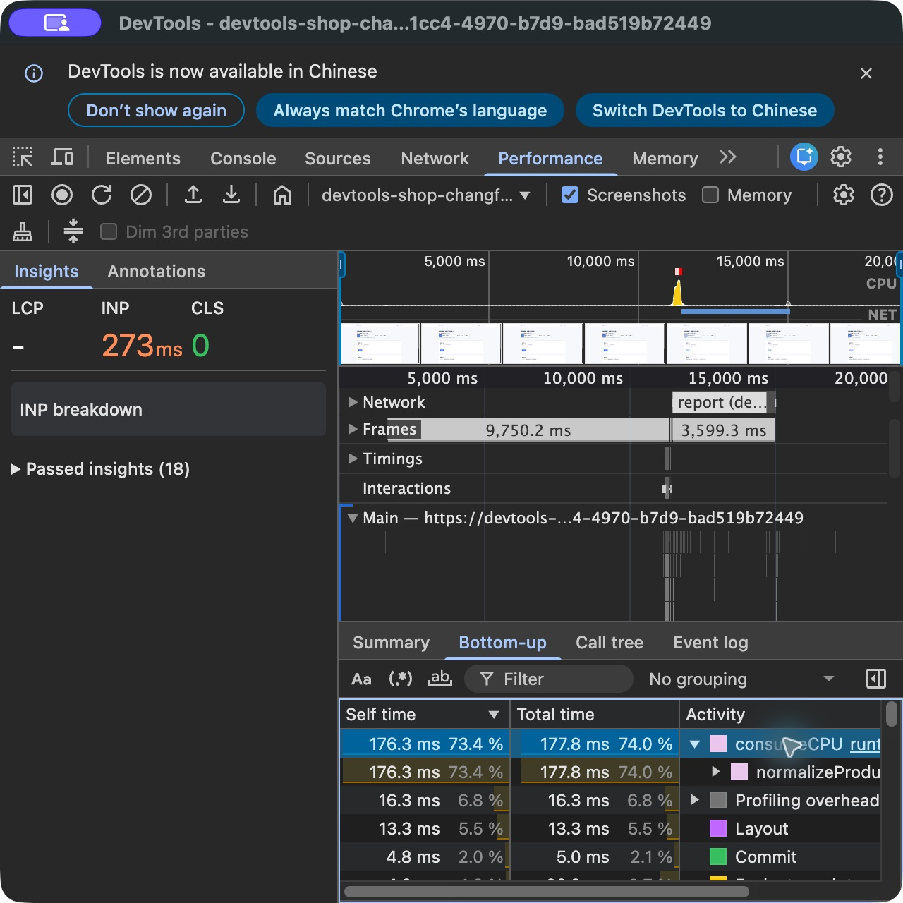
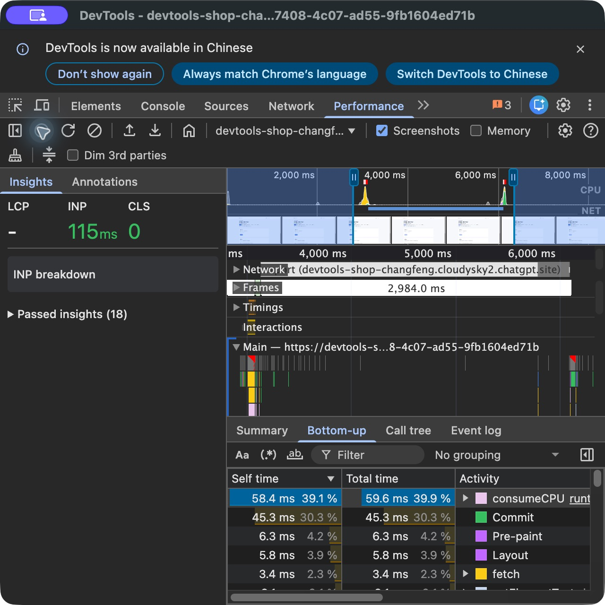
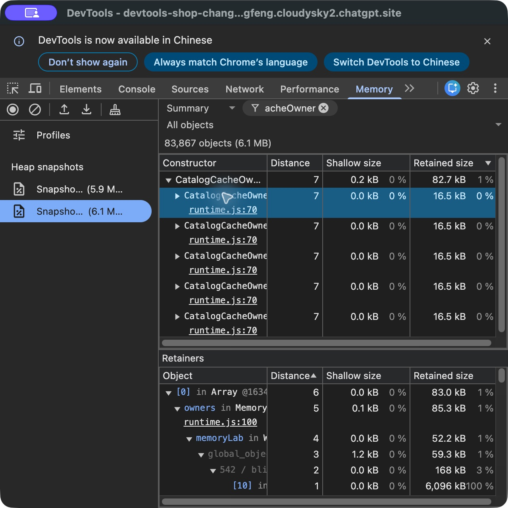
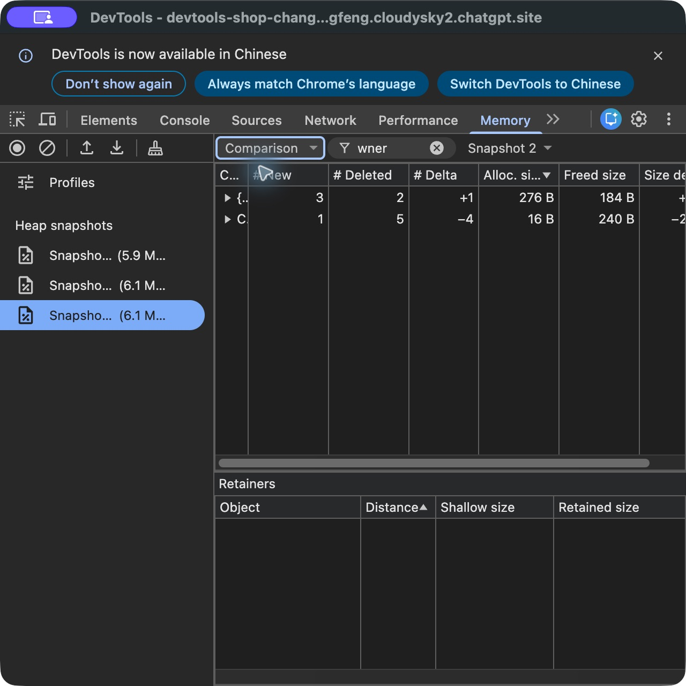

# 线上 Performance / Memory / Lighthouse 原生验收

日期：2026-10-27。状态：Performance / Memory 核心通过，Lighthouse 原生复验待补。目标为现有公开教程与商城，使用独立 Chrome 访客窗口和英文 DevTools。历史本地报告、接口夹具与页面计数不计作本轮原生通过。

## 执行矩阵

| 类别 | 实际操作与结果 | 状态 |
| --- | --- | --- |
| Performance 录制与文件 | 第 29 课故障 / 修复各一次原生 Record / Stop、Save gzip trace；故障文件 Load 后 INP 与 Bottom-up 一致 | 通过；修复文件回载待补 |
| Performance 根因与对照 | Bottom-up 展开 consumeCPU → normalizeProduct，源码链接打开实际 runtime.js 第 131 行；同一业务操作的 Total time 177.8 → 59.6 ms，校验值均为 84 | 通过；Call tree 仅打开视图，详细展开待补 |
| Memory 快照与根 | 第 41 课同文档空闲 / 故障 / 修复三快照；故障 5 个 CatalogCacheOwner，Retainers 到 memoryLab / Window / GC roots | 通过 |
| Memory 比较与文件 | Snapshot 3 vs 2：新增 1、删除 5、净减 4；三快照保存，修复快照回载后仍为 1 个 owner / 16.7 kB | 通过 |
| Lighthouse 原生模式 | 需本轮实际 Navigation / Timespan / Snapshot 与真实 JSON 导出 | 待验，无本轮原生报告 |
| Lighthouse 导入与修复 | 修复缺少审计模式的比较条件及第 47 课模式约束，已发布商城 v5 | 代码 / 接口通过；实际原生报告导入待验 |
| Lighthouse 性能对照 | 同条件两阶段各三份独立 Navigation；保留全部样本与中位数 | 待验，不复用历史本地数字 |
| 恢复 | Performance 两轮停止；Memory 停止并清理后关闭实验标签；CPU / Network 未启用限速；访客窗口已混入其他工作页面，保留窗口避免误关 | 本任务负载清理完成，未关闭整个访客窗口 |

## Performance：真实线上录制

[机器摘要与原始文件哈希](qa/site/native-2026-10-27/performance.json)。原生 Record 在场景准备后开始，每轮只执行一次目标操作；准备场景的导航未包含在录制中。Screenshots 开启，CPU / Network 为 No throttling。故障侧运行于商城 v4，修复侧 v5；两版 Performance runtime 未改变，v5 仅修改 Lighthouse 报告校验。

| 实际观察 | 故障 | 缓存归一化结果后 |
| --- | ---: | ---: |
| 页面 normalizeProduct 调用 | 1 | 1 |
| 页面累计计时 | 180.1 ms | 60 ms |
| 原生 consumeCPU Self time | 176.3 ms | 58.4 ms |
| 原生 consumeCPU Total time | 177.8 ms | 59.6 ms |
| 原生录制 INP | 273 ms | 115 ms |
| 业务数量 / 校验值 | 2 / 84 | 2 / 84 |

已从 consumeCPU 展开 normalizeProduct，并打开实际源文件。两份 gzip trace 均由 DevTools 的 Save trace 导出，未勾选 Include resource content；故障文件经 Load trace 回载后，INP 273 ms 与 consumeCPU 176.3 / 177.8 ms 保持一致。修复文件保存成功，尚未回载。Call tree 已切换查看，完整调用展开仍待补。

两轮录制时长和 UI 选区不同，仅比较相同目标操作的函数工作量；不比较整个 trace 的总 CPU 百分比。INP 为本次录制实际显示值，不是跨设备承诺；60 ms 仍可能形成长任务，不能宣称已消除所有长任务。

## Lighthouse 模式校验修复

旧 importer 的 condition 未包含 gatherMode，Navigation、Timespan、Snapshot 可产生相同条件键。现在要求原始 JSON 提供已支持的模式，摘要与界面显示模式，比较条件包含模式；第 47 课明确只接受 Navigation，评估时再次检查。缺失 / 未知模式、跨模式比较和拒绝后报告名额均有回归测试。

商城 v5 已成功发布，精确源码与版本见[部署记录](qa/site/deployments.json)。[61 项 Node 测试](qa/site/native-2026-10-27/node-tests.txt)、[10 项 Workers / D1 测试](qa/site/native-2026-10-27/hosted-tests.txt)、[构建与类型检查](qa/site/native-2026-10-27/build.txt)通过。[v5 线上 HTTP 79/79](qa/site/native-2026-10-27/http-v5.json)及[线上模式拒绝检查](qa/site/native-2026-10-27/lighthouse-mode-http.json)通过：第 47 课 Timespan / Snapshot 均 HTTP 400，未提交合成 Navigation 或写学习记录。这些是代码和协议证据，不是本轮原生 Lighthouse 报告。

## Memory：同文档快照与回载

[机器摘要、实际堆中的命名对象数目与原始哈希](qa/site/native-2026-10-27/memory.json)。空闲 Snapshot 1 在故障准备前采集；随后准备故障、重复 5 次开关，Snapshot 2 显示 5 个 CatalogCacheOwner，组 Shallow Size 约 0.2 kB、Retained Size 82.7 kB。实际 Retainers 为 `[0] in Array → owners in MemoryLabState → memoryLab in Window → NativeContext / Global handles → GC roots`。

同文档应用只保留当前 owner 的对照，再做 5 次相同操作、原生 Collect garbage 与 Snapshot 3。Summary 剩 1 个 owner / 16.7 kB；Comparison 以 Snapshot 2 为基线，新增 1、删除 5、净减 4，分配 16 B、释放 240 B、Size delta −224 B。这里字节差为对象自身，不等同于全部载荷释放大小。

三份快照均由 Save profile 导出，修复快照经 Load profile 回载并选中，仍显示一个 CatalogCacheOwner / 16.7 kB。故障与修复五次操作均得到 CUP-42、数量 2、校验值 84。正常保留当前 owner 合理，不要求所有对象归零。停止清理后页面自有 owner 数为 0，已关闭实验标签；未额外拍清理后快照，不声称 GC 后全部为 0。Allocation 工具、Detached DOM 与第二根配置未在本轮线上重测。

## 中断与继续条件

原生 Chrome 多次从本任务访客窗口切到其他工作窗口，并发生工具超时和截图不可用。Memory 开始时大按钮显示 **Another profiler is already active**，用户停止其他录制后，工具栏成功生成快照，之后取得完整核心证据；初始提示不作为最终阻塞结论。准备 Lighthouse 时，访客窗口新增其他工作页面并被持续切换，无法继续保持专用审计条件，根因未确定。保留这些页面和整个访客窗口，避免影响其他工作；本任务 Memory 负载已清理、目标标签关闭。

后续退出条件为：Performance 修复 trace 回载与 Call tree 详细展开；Lighthouse 三模式真实导出、45 / 46 导入与人工业务路径，以及 47 相同版本 / 设备 / 类别 / 限速 / 缓存条件的三次中位数。Android 真机、定位权限、AI 账户等与本轮无关的条件项目继续单列在[部署说明](DEPLOYMENT.md#原生工具与额外条件)。

## 证据与环境边界

原生导出保存在 `/private/tmp/devtools-online-native-2026-10-27/`；公开仓库只保存已检查的工具截图、摘要与 SHA-256，不上传完整 trace / 堆中的非项目数据。读取和归纳不会改写原始指标。未修改公司 VPN、DNS、系统代理、证书或个人浏览器资料。
